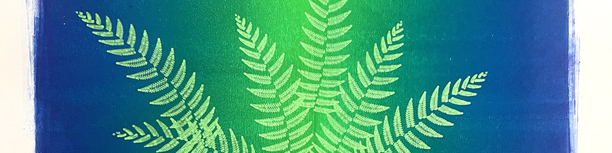

### Hi, I'm Summer! 👋

I'm a generative artist and programmer  who specializes in functional programming. I spend a lot of time playing with graphics, especially SVGs, and making art. I'm currently using the [Processing](https://processing.org/) language and framework to make SVGs that I can draw with my AxiDraw pen plotter. Check out my generative repos (pinned) or visit [my website](https://summasmiff.github.io) to see my art!

